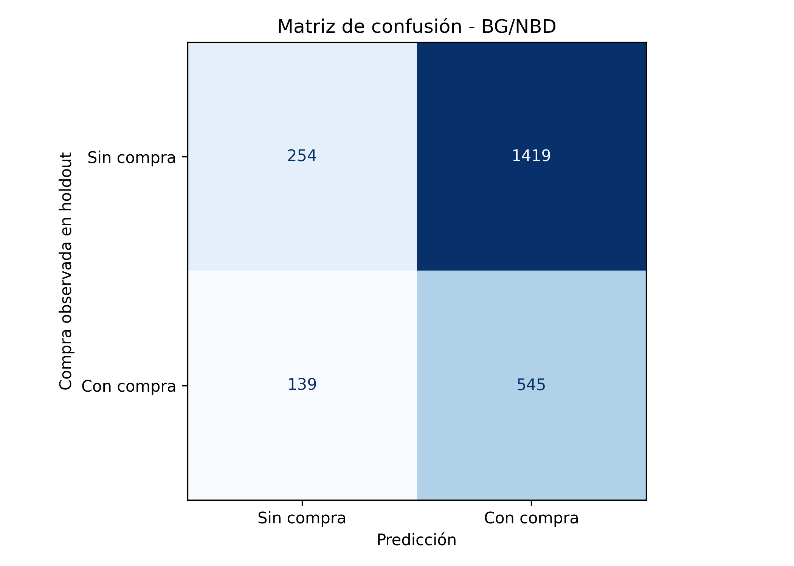
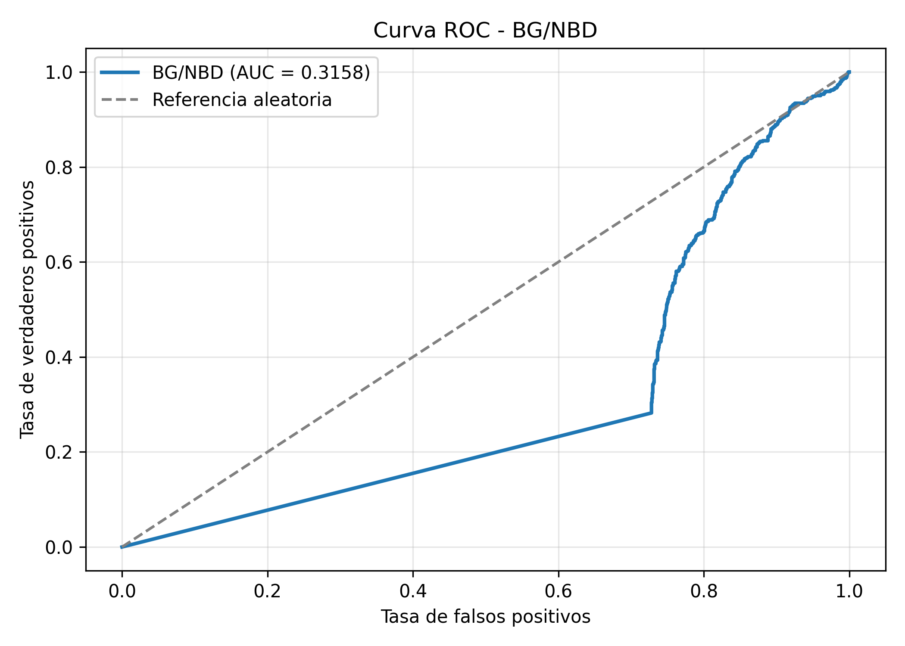

# Probabilidad de clientes activos y evaluación del modelo BG/NBD

## 1. Objetivo

Calcular la probabilidad de que los clientes continúen activos mediante el modelo BG/NBD y evaluar su capacidad para distinguir entre clientes que realizaron al menos una compra durante el período de evaluación (holdout) y aquellos que no realizaron compras.

Para ello, se calcularon las probabilidades individuales de seguir activo, una matriz de confusión, métricas de clasificación, la curva ROC y el área bajo la curva (AUC).

## 2. Datos utilizados

Se utilizó el conjunto de datos CDNOW, previamente procesado y dividido en períodos de calibración y evaluación.

El archivo `data/procesado/cdnow_rfm.csv` contiene la información de 2,357 clientes.

Las variables utilizadas fueron:

| Variable | Descripción |
|---|---|
| id | Identificador del cliente |
| x | Número de compras repetidas durante la calibración |
| tx | Tiempo transcurrido hasta la última compra repetida |
| T | Tiempo total de observación durante la calibración |
| x_star | Número de compras observadas durante el holdout |

También se utilizaron los parámetros estimados del modelo BG/NBD, almacenados en `resultados/tablas/params_cdnow.csv`.

| Parámetro | Valor estimado |
|---|---:|
| r | 0.2426 |
| α | 4.4136 |
| a | 0.7929 |
| b | 2.4259 |

## 3. Cálculo de la probabilidad de seguir activo

En el modelo BG/NBD, la probabilidad de que un cliente continúe activo al finalizar el período de calibración depende de su frecuencia de compra, el tiempo de su última compra repetida, el tiempo total de observación y los parámetros estimados.

La probabilidad condicional se calcula mediante:

$$
P(\text{vivo}\mid x,t_x,T)=
\begin{cases}
1, & x=0 \\[6pt]
\displaystyle
\frac{1}{
1+\frac{a}{b+x-1}
\left(\frac{\alpha+T}{\alpha+t_x}\right)^{r+x}
}, & x>0
\end{cases}
$$

Para los clientes con $x=0$, la probabilidad de seguir activo es igual a uno según los supuestos del modelo BG/NBD, debido a que el abandono solamente puede ocurrir después de una compra repetida.

Para los clientes con $x>0$, la probabilidad se calcula utilizando la expresión condicional correspondiente.

El cálculo se implementó en el archivo `src/clientes_activos.py`.

## 4. Resultados de las probabilidades estimadas

Se calcularon las probabilidades individuales de seguir activo para los 2,357 clientes.

| Estadística | Resultado |
|---|---:|
| Clientes evaluados | 2,357 |
| Probabilidad media | 0.8134 |
| Desviación estándar | 0.2721 |
| Probabilidad mínima | 0.0000 |
| Primer cuartil | 0.6604 |
| Mediana | 1.0000 |
| Tercer cuartil | 1.0000 |
| Probabilidad máxima | 1.0000 |

La probabilidad media estimada de seguir activo fue de aproximadamente 81.34 %.

Sin embargo, este resultado no significa que el 81.34 % de los clientes necesariamente realizará una compra durante el holdout. La probabilidad de seguir activo y la probabilidad de realizar una compra futura representan conceptos diferentes.

La mediana igual a uno está relacionada con la presencia de numerosos clientes que no realizaron compras repetidas durante la calibración.

## 5. Evaluación mediante compras observadas

Para evaluar las probabilidades estimadas se construyó una variable binaria a partir de las compras observadas durante el holdout:

$$
y_i =
\begin{cases}
1, & x_i^*>0 \\[4pt]
0, & x_i^*=0
\end{cases}
$$

Se utilizó un umbral de 0.5 sobre la probabilidad de seguir activo:

$$
\hat{y}_i =
\begin{cases}
1, & P(\text{vivo})\geq 0.5 \\[4pt]
0, & P(\text{vivo})<0.5
\end{cases}
$$

La etiqueta positiva indica que el cliente realizó al menos una compra durante el holdout.

Esta evaluación utiliza las compras observadas como una variable de referencia. No representa una medición directa del estado real de abandono, ya que un cliente puede continuar activo sin realizar compras durante el período evaluado.

### Distribución de las etiquetas observadas

| Comportamiento en holdout | Clientes | Porcentaje |
|---|---:|---:|
| Sin compras | 1,673 | 70.98 % |
| Con al menos una compra | 684 | 29.02 % |
| Total | 2,357 | 100.00 % |

## 6. Matriz de confusión

La matriz de confusión obtenida fue:

| Valor real | Predicción: sin compra | Predicción: con compra |
|---|---:|---:|
| Sin compra | 254 | 1,419 |
| Con compra | 139 | 545 |

### Interpretación

El modelo identificó correctamente a 545 clientes que realizaron al menos una compra durante el holdout, mientras que clasificó como posibles compradores a 1,419 clientes que no realizaron compras.

También clasificó correctamente a 254 clientes sin compras y no identificó a 139 clientes que sí compraron.

Estos resultados muestran que, utilizando directamente la probabilidad de seguir activo y un umbral de 0.5, se generan numerosas predicciones positivas que no coinciden con las compras observadas.

## 7. Métricas de clasificación

Los resultados obtenidos fueron:

| Métrica | Sin compra | Con compra |
|---|---:|---:|
| Precisión | 0.65 | 0.28 |
| Recall | 0.15 | 0.80 |
| F1-score | 0.25 | 0.41 |
| Soporte | 1,673 | 684 |

La exactitud global fue aproximadamente del 34 %.

El recall de 0.80 para la clase positiva indica que se identificó una proporción elevada de los clientes que realizaron compras. Sin embargo, la precisión de 0.28 indica que una gran cantidad de clientes clasificados como compradores no realizó compras durante el holdout.

La exactitud global es baja debido principalmente a la elevada cantidad de falsos positivos.

## 8. Curva ROC y AUC

La curva ROC representa la relación entre la tasa de verdaderos positivos y la tasa de falsos positivos al modificar el umbral de clasificación.

El área bajo la curva ROC obtenida para todos los clientes fue:

$$
AUC_{\text{global}}=0.315790
$$

### Interpretación

El AUC global de 0.315790 indica una capacidad de discriminación inferior a la referencia aleatoria de 0.5 para distinguir entre clientes que realizaron compras y clientes que no realizaron compras durante el holdout, utilizando directamente $P(\text{vivo})$ como puntuación.

Este resultado no demuestra por sí solo que el modelo BG/NBD esté incorrectamente ajustado, debido a que la probabilidad de seguir activo no equivale directamente a la probabilidad de realizar una compra futura.

## 9. Análisis adicional de clientes sin compras repetidas

Se realizó un análisis adicional para investigar el comportamiento del AUC global.

De los 2,357 clientes, 1,411 no realizaron compras repetidas durante la calibración, por lo que tienen $x=0$.

| Grupo | Clientes | Compraron en holdout | No compraron |
|---|---:|---:|---:|
| x = 0 | 1,411 | 193 | 1,218 |
| x > 0 | 946 | 491 | 455 |
| Total | 2,357 | 684 | 1,673 |

De acuerdo con los supuestos del BG/NBD, todos los clientes con $x=0$ reciben una probabilidad de seguir activo igual a uno.

Sin embargo, solamente 193 de estos clientes realizaron al menos una compra durante el holdout, mientras que los otros 1,218 no realizaron compras.

Esta situación contribuye al bajo desempeño de la clasificación global, debido a que una probabilidad elevada de seguir activo no garantiza que se observe una compra futura.

### Comparación de probabilidades medias

| Compras en holdout | Clientes | Media de P(vivo) | Mediana |
|---|---:|---:|---:|
| Sin compras | 1,673 | 0.8518 | 1.0000 |
| Con compras | 684 | 0.7195 | 0.7537 |

La probabilidad media de seguir activo fue mayor entre los clientes que no realizaron compras durante el holdout. Esto refleja la diferencia entre el estado latente de actividad estimado por el modelo y la ocurrencia observable de compras futuras.

### AUC para clientes con compras repetidas

Se calculó nuevamente el AUC considerando únicamente a los clientes con $x>0$ durante la calibración.

El resultado fue:

$$
AUC_{x>0}=0.698357
$$

Este resultado indica una capacidad de discriminación moderada dentro del subconjunto de clientes que realizaron al menos una compra repetida durante la calibración.

La diferencia entre ambos resultados es considerable:

| Evaluación | Clientes | AUC |
|---|---:|---:|
| Todos los clientes | 2,357 | 0.315790 |
| Clientes con x > 0 | 946 | 0.698357 |

El resultado de 0.698357 corresponde exclusivamente al subconjunto con compras repetidas y no debe presentarse como el desempeño global del modelo.

El análisis principal conserva a todos los clientes para evitar una selección artificial de los casos evaluados.

## 10. Discusión

Los resultados muestran una limitación importante al utilizar directamente $P(\text{vivo})$ como clasificador de compras futuras.

El modelo BG/NBD distingue entre la probabilidad de que un cliente permanezca activo y su tasa individual de compra. Por lo tanto, un cliente puede continuar activo y no realizar ninguna compra durante el período de evaluación.

Además, el supuesto de que los clientes con $x=0$ permanecen activos con probabilidad uno produce una concentración de puntuaciones máximas en clientes que pueden no realizar compras futuras.

La mejora del AUC al considerar únicamente clientes con $x>0$ muestra que el comportamiento de los clientes sin compras repetidas influye considerablemente en la evaluación global.

Por estas razones, las métricas obtenidas deben interpretarse como una evaluación de la relación entre $P(\text{vivo})$ y la compra observada, no como una validación directa del estado real de abandono.

## 11. Implementación

Se implementó el archivo `src/clientes_activos.py`, utilizando NumPy, Pandas, Matplotlib y scikit-learn.

El procedimiento consistió en cargar los datos procesados y los parámetros estimados, calcular $P(\text{vivo})$ para cada cliente, construir las etiquetas de compra observada, aplicar un umbral de clasificación, calcular las métricas y generar las gráficas correspondientes.

También se incorporó un análisis adicional para comparar las probabilidades estimadas según el comportamiento observado y calcular el AUC para los clientes con compras repetidas durante la calibración.

Los resultados se guardaron en:

- `resultados/tablas/clientes_activos.csv`
- `resultados/graficas/matriz_confusion_clientes.png`
- `resultados/graficas/roc_clientes.png`

## 12. Conclusiones

Se calculó la probabilidad de seguir activo para los 2,357 clientes de CDNOW utilizando los parámetros estimados del modelo BG/NBD.

La evaluación global mediante compras observadas produjo una exactitud aproximada del 34 % y un AUC de 0.315790, evidenciando que la probabilidad de seguir activo no funciona adecuadamente como clasificador directo de compras futuras para el conjunto completo de clientes.

El análisis adicional mostró que los 1,411 clientes sin compras repetidas durante la calibración influyen considerablemente en este resultado, debido a que reciben una probabilidad de seguir activo igual a uno según los supuestos del modelo.

Al evaluar únicamente a los 946 clientes con compras repetidas, el AUC aumentó a 0.698357, lo que indica una mejor capacidad de discriminación dentro de ese subconjunto.

En conclusión, los resultados permiten identificar las limitaciones de utilizar $P(\text{vivo})$ como indicador directo de compras futuras y resaltan la importancia de distinguir entre la actividad latente de un cliente y la ocurrencia observable de transacciones.

## 13. Archivos relacionados

- `src/clientes_activos.py`: cálculo de probabilidades y evaluación.
- `src/bgnbd.py`: funciones principales del modelo BG/NBD.
- `data/procesado/cdnow_rfm.csv`: datos de clientes.
- `resultados/tablas/params_cdnow.csv`: parámetros estimados.
- `resultados/tablas/clientes_activos.csv`: probabilidades y clasificaciones.
- `resultados/graficas/matriz_confusion_clientes.png`: matriz de confusión.
- `resultados/graficas/roc_clientes.png`: curva ROC.
