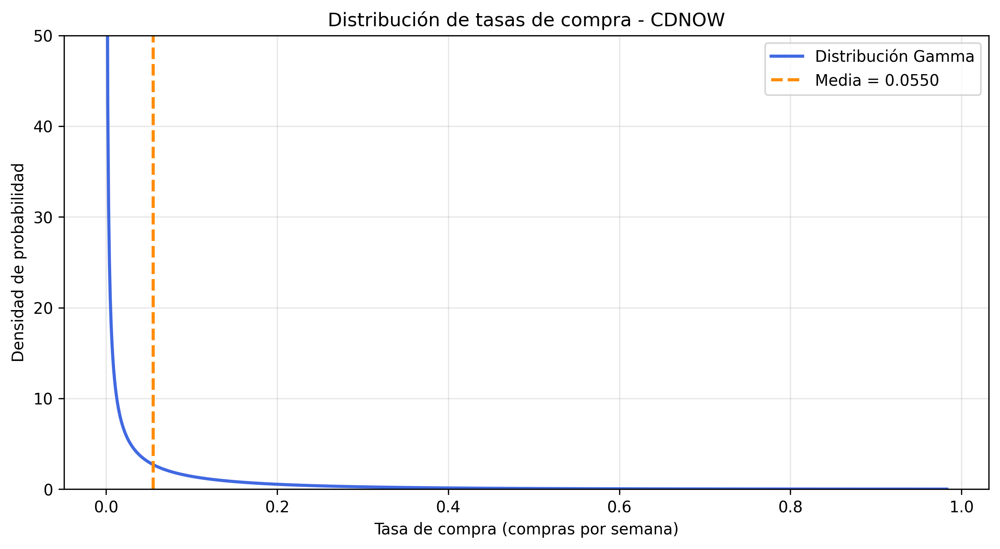
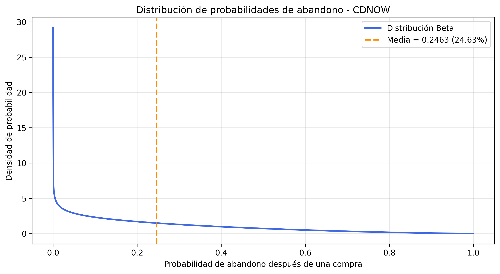

# Distribuciones de tasas de compra y probabilidades de abandono — BG/NBD

## 1. Objetivo

Visualizar e interpretar las distribuciones de las tasas de compra y las probabilidades de abandono estimadas por el modelo BG/NBD a partir de los datos CDNOW, utilizando los parámetros obtenidos mediante máxima verosimilitud.

## 2. Parámetros utilizados

Las distribuciones se construyeron utilizando los parámetros estimados del modelo BG/NBD.

| Parámetro | Valor |
|---|---:|
| r | 0.2426 |
| α | 4.4136 |
| a | 0.7929 |
| b | 2.4259 |

Los parámetros se cargaron desde `resultados/tablas/params_cdnow.csv`.

## 3. Distribución Gamma de las tasas de compra

En el modelo BG/NBD, las tasas individuales de compra siguen una distribución Gamma:

$$
\lambda \sim \operatorname{Gamma}(r,\alpha)
$$

Donde $r$ es el parámetro de forma y $\alpha$ es el parámetro de tasa.

La media se calcula mediante:

$$
E[\lambda] = \frac{r}{\alpha}
$$

Con los parámetros estimados:

$$
E[\lambda] = \frac{0.2426}{4.4136} \approx 0.054965
$$

### Gráfica

### Interpretación

La distribución Gamma presenta una concentración elevada de densidad cerca de cero, seguida de una disminución progresiva conforme aumenta la tasa de compra.

Este comportamiento es coherente con el parámetro de forma estimado, $r=0.2426$, que es menor que uno. La distribución indica que las tasas de compra pequeñas tienen mayor densidad, mientras que las tasas elevadas son menos frecuentes según el modelo.

La línea vertical naranja representa la tasa media estimada de 0.054965 compras repetidas por semana mientras un cliente permanece activo.

La gráfica utiliza un límite vertical de 50 para facilitar la visualización. Este ajuste únicamente modifica la escala mostrada y no altera la distribución ni los parámetros estimados.

## 4. Distribución Beta de las probabilidades de abandono

En BG/NBD, las probabilidades individuales de abandono siguen una distribución Beta:

$$
p \sim \operatorname{Beta}(a,b)
$$

La media se calcula mediante:

$$
E[p] = \frac{a}{a+b}
$$

Sustituyendo los parámetros estimados:

$$
E[p] = \frac{0.7929}{0.7929+2.4259} \approx 0.246338
$$

### Gráfica

### Interpretación

La distribución Beta presenta mayor densidad cerca de cero y disminuye conforme aumenta la probabilidad de abandono.

Esta forma es coherente con los parámetros estimados, $a=0.7929$ y $b=2.4259$, e indica que las probabilidades individuales de abandono pequeñas tienen mayor densidad dentro de la población modelada.

La línea vertical naranja representa la probabilidad media de abandono, equivalente al 24.63 % después de una compra.

Este porcentaje no corresponde a una tasa semanal de abandono, ya que el modelo BG/NBD considera que el abandono puede ocurrir después de una compra.

## 5. Implementación

Para generar las gráficas se implementó el archivo `src/graficar_distribuciones.py`.

El procedimiento consistió en cargar los parámetros estimados de CDNOW, calcular las funciones de densidad de probabilidad mediante `scipy.stats.gamma` y `scipy.stats.beta`, representar sus curvas con Matplotlib y señalar sus respectivas medias.

Para la distribución Gamma se utilizó `scale=1/alpha`, debido a que SciPy emplea el parámetro de escala, mientras que el modelo BG/NBD utiliza el parámetro de tasa.

Las gráficas se guardaron en:

- `resultados/graficas/distribucion_lambda.png`
- `resultados/graficas/distribucion_p.png`

## 6. Resultados y conclusiones

Las dos gráficas presentan formas coherentes con los parámetros estimados del modelo BG/NBD.

La distribución Gamma muestra que las tasas de compra presentan una concentración de densidad cerca de cero, mientras que la distribución Beta indica una mayor densidad para probabilidades individuales de abandono pequeñas.

Ambas distribuciones reflejan la heterogeneidad de los clientes, ya que el modelo no supone que todos compran con la misma frecuencia ni que tienen la misma probabilidad de abandonar.

Las gráficas permiten complementar la interpretación numérica de los parámetros y visualizar el comportamiento probabilístico estimado para la población de CDNOW.

## 7. Archivos relacionados

- `src/graficar_distribuciones.py`: generación de las gráficas.
- `src/interpretacion_parametros.py`: cálculo de estadísticas de Gamma y Beta.
- `resultados/tablas/params_cdnow.csv`: parámetros estimados.
- `resultados/graficas/distribucion_lambda.png`: gráfica Gamma.
- `resultados/graficas/distribucion_p.png`: gráfica Beta.
- `documentos/interpretacion_parametros.md`: interpretación numérica de las distribuciones.
