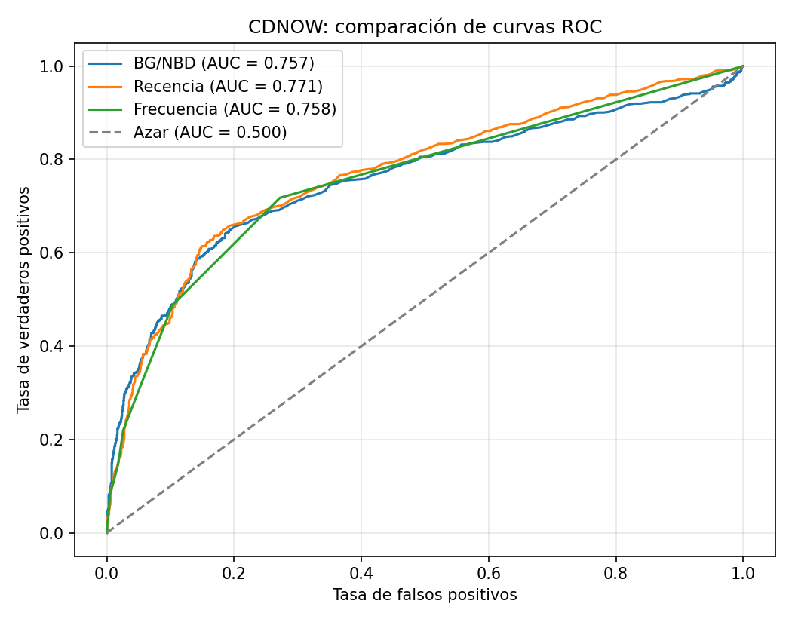
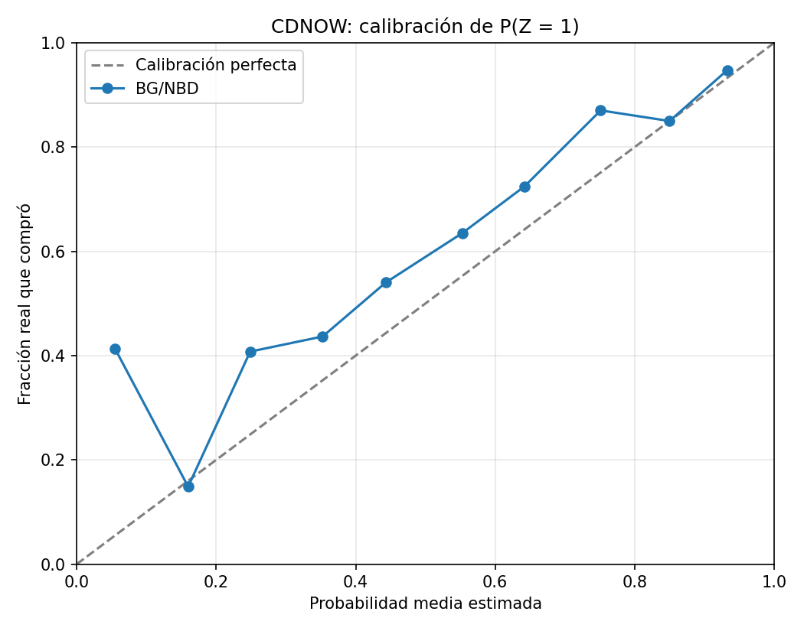

# Evaluación de la probabilidad de compra en CDNOW

## 1. Objetivo

Evaluar la capacidad del modelo BG/NBD para predecir si un cliente realizará al menos una compra durante el período de holdout.

Se calcularon las métricas AUC-ROC y Brier Score, se analizó la calibración de las probabilidades y se comparó el modelo contra tres referencias: recencia, frecuencia y tasa base.

Este análisis corresponde al inciso 4.5.

## 2. Datos utilizados

Se utilizó el archivo `resultados/tablas/prob_compra.csv`, generado previamente mediante `src/prob_compra.py`.

El archivo contiene las variables RFM de calibración, las compras observadas en holdout y las probabilidades estimadas mediante BG/NBD.

Se analizaron 2,357 clientes:

- 684 realizaron al menos una compra durante holdout.
- 1,673 no realizaron compras durante holdout.
- La tasa real de compra fue de 29.02 %.

La variable objetivo se definió como:

$$
Z_i =
\begin{cases}
1, & x_i^* \geq 1 \\
0, & x_i^* = 0
\end{cases}
$$

La probabilidad estimada por BG/NBD corresponde a:

$$
P(Z_i=1 \mid x_i,t_{x,i},T_i)
$$

Es decir, la probabilidad de realizar al menos una compra durante las siguientes 39 semanas.

Se utilizó esta probabilidad en lugar de $P(\text{vivo})$, ya que un cliente puede permanecer activo sin realizar compras durante holdout.

## 3. Métodos de comparación

Se evaluaron cuatro métodos:

| Método | Descripción |
|---|---|
| BG/NBD | Probabilidad de realizar al menos una compra en holdout |
| Recencia | Puntuación basada en el tiempo desde la última compra |
| Frecuencia | Puntuación basada en el número de compras repetidas |
| Tasa base | Probabilidad constante igual a la proporción observada de compradores |

Para recencia se utilizó:

$$
s_{\text{recencia}}=-(T-t_x)
$$

Un valor mayor indica una compra más reciente.

Para frecuencia se utilizó:

$$
s_{\text{frecuencia}}=x
$$

Un valor mayor indica más compras repetidas durante calibración.

La tasa base se calculó como:

$$
p_{\text{base}}=\frac{684}{2357}\approx0.2902
$$

La recencia y la frecuencia se utilizaron como puntuaciones de clasificación, no como probabilidades calibradas.

## 4. Evaluación mediante AUC-ROC

El AUC mide la capacidad de ordenar a los clientes según su probabilidad o puntuación de compra.

Un AUC de 0.5 representa discriminación equivalente al azar, mientras que un valor de 1 representa discriminación perfecta.

Los resultados fueron:

| Método | AUC |
|---|---:|
| Recencia | 0.7714 |
| Frecuencia | 0.7576 |
| BG/NBD | 0.7569 |
| Tasa base | 0.5000 |

Los tres métodos basados en información del historial de compras superaron claramente a la tasa base.

La recencia obtuvo el mayor AUC, con 0.7714, seguida por frecuencia con 0.7576 y BG/NBD con 0.7569.

Esto indica que la recencia presentó una capacidad de discriminación ligeramente superior en este conjunto de datos.

Sin embargo, las diferencias entre los tres métodos fueron relativamente pequeñas y no se realizó una prueba de significancia estadística.

El resultado también muestra que un modelo probabilístico más elaborado no necesariamente supera a una regla sencilla cuando la evaluación se concentra únicamente en la discriminación.

## 5. Evaluación mediante Brier Score

El Brier Score mide el error cuadrático medio entre las probabilidades estimadas y los resultados binarios observados.

Se calcula mediante:

$$
BS=\frac{1}{N}\sum_{i=1}^{N}(p_i-Z_i)^2
$$

Donde:

- $N$ es el número de clientes.
- $p_i$ es la probabilidad estimada.
- $Z_i$ es el resultado real de compra.

Un Brier menor indica mejores predicciones probabilísticas.

Los resultados fueron:

| Método | Brier Score |
|---|---:|
| BG/NBD | 0.1612 |
| Tasa base | 0.2060 |

No se calculó Brier directamente para recencia y frecuencia porque sus puntuaciones no representan probabilidades calibradas.

La mejora relativa de BG/NBD frente a la tasa base fue:

$$
\text{Mejora}
=
\left(1-\frac{0.1612238}{0.2059837}\right)\times100
$$

$$
\text{Mejora}\approx21.73\%
$$

Por lo tanto, BG/NBD redujo el error cuadrático medio de las probabilidades aproximadamente un 21.73 % frente a utilizar una probabilidad constante para todos los clientes.

Esto indica que el modelo aporta información predictiva adicional respecto a la tasa base.

## 6. Análisis de calibración

La calibración permite evaluar si las probabilidades estimadas corresponden a las frecuencias de compra observadas.

Por ejemplo, un modelo bien calibrado debería producir una frecuencia real cercana al 30 % entre los clientes a quienes asigna una probabilidad aproximada del 30 %.

Para evaluar la calibración se dividieron las probabilidades estimadas en diez intervalos de amplitud 0.1.

### 6.1. Resultados

| Intervalo | Clientes | Probabilidad media | Frecuencia real |
|---|---:|---:|---:|
| 0.0–0.1 | 46 | 0.0551 | 0.4130 |
| 0.1–0.2 | 1,581 | 0.1598 | 0.1486 |
| 0.2–0.3 | 130 | 0.2487 | 0.4077 |
| 0.3–0.4 | 158 | 0.3527 | 0.4367 |
| 0.4–0.5 | 137 | 0.4431 | 0.5401 |
| 0.5–0.6 | 74 | 0.5530 | 0.6351 |
| 0.6–0.7 | 98 | 0.6419 | 0.7245 |
| 0.7–0.8 | 54 | 0.7513 | 0.8704 |
| 0.8–0.9 | 60 | 0.8501 | 0.8500 |
| 0.9–1.0 | 19 | 0.9326 | 0.9474 |

### 6.2. Interpretación

La línea diagonal representa la calibración perfecta.

Los puntos situados por encima de esta línea indican que la frecuencia real de compra fue superior a la probabilidad estimada. En esos intervalos, el modelo subestimó la probabilidad de compra.

Los puntos situados por debajo indican sobreestimación.

En varios intervalos intermedios, BG/NBD subestimó la frecuencia real de compra.

Por ejemplo, entre 0.2 y 0.3, la probabilidad media estimada fue de 24.87 %, mientras que la frecuencia observada fue de 40.77 %.

En cambio, entre 0.8 y 0.9, la probabilidad estimada fue de 85.01 % y la frecuencia real fue de 85.00 %, lo que representa una coincidencia prácticamente exacta.

El primer intervalo presentó una desviación considerable: una probabilidad media estimada de 5.51 % frente a una frecuencia real de 41.30 %.

Este resultado requiere atención, aunque el grupo contiene únicamente 46 clientes.

Además, los tamaños de los intervalos son desiguales. El grupo de 0.1 a 0.2 concentra 1,581 clientes, mientras que otros intervalos contienen menos de 100.

Por lo tanto, la calibración no es uniforme y las desviaciones deben interpretarse considerando el número de clientes de cada grupo.

## 7. Interpretación conjunta

Los resultados muestran que BG/NBD tiene una capacidad de discriminación razonable, con AUC de 0.7569.

Sin embargo, la recencia obtuvo un AUC ligeramente superior, lo que indica que una medida sencilla del historial de compras puede ser competitiva para ordenar a los clientes según su probabilidad de comprar.

Por otra parte, BG/NBD proporciona probabilidades individuales, lo que permite evaluar su calidad mediante Brier Score y calibración.

El Brier de 0.1612 fue inferior al de la tasa base, de 0.2060, mostrando una mejora relativa de 21.73 %.

La calibración reveló diferencias entre las probabilidades estimadas y las frecuencias reales, principalmente en algunos intervalos de probabilidad baja e intermedia.

Esto indica que una buena capacidad de discriminación no garantiza una calibración perfecta.

## 8. Archivos utilizados y generados

### Archivos de entrada

- `resultados/tablas/prob_compra.csv`

### Programa

- `src/evaluar_prob_compra.py`

### Archivos de salida

- `resultados/tablas/evaluacion_prob_compra.csv`
- `resultados/tablas/calibracion_prob_compra.csv`
- `resultados/graficas/roc_comparacion_compra.png`
- `resultados/graficas/calibracion_prob_compra.png`

## 9. Conclusiones

La evaluación del modelo BG/NBD sobre los 2,357 clientes de CDNOW permitió analizar su capacidad para predecir compras durante el período de holdout.

El modelo obtuvo un AUC de 0.7569 y un Brier Score de 0.1612.

La recencia presentó el mayor AUC, con 0.7714, mientras que frecuencia obtuvo 0.7576. Esto demuestra que las reglas sencillas basadas en el historial de compras pueden resultar competitivas para la clasificación de clientes.

Sin embargo, BG/NBD mejoró el Brier Score de la tasa base en un 21.73 %, lo que evidencia el valor de utilizar probabilidades individuales en lugar de una predicción constante.

El análisis de calibración mostró que el modelo subestima la frecuencia real de compra en varios intervalos, aunque presenta una buena correspondencia en otros.

En conclusión, BG/NBD proporciona probabilidades predictivas útiles y supera a la tasa base en error probabilístico, pero no presenta la mayor discriminación entre los métodos evaluados y todavía muestra oportunidades de mejora en calibración.
