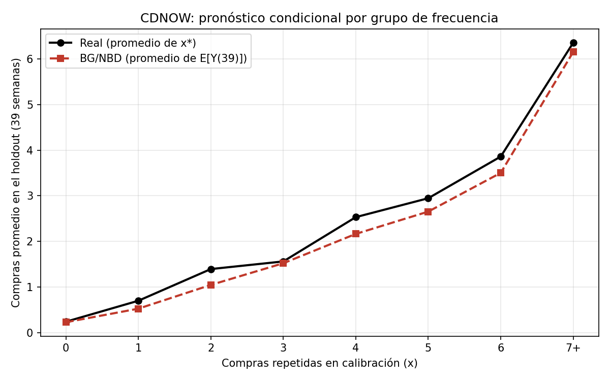

# Interpretación de las diferencias entre los métodos de pronóstico

## 1. Objetivo

Analizar e interpretar las diferencias entre los métodos de pronóstico Bottom-Up y Top-Down aplicados al conjunto de datos CDNOW, utilizando las compras repetidas observadas durante el período de holdout como referencia.

Se comparan los totales pronosticados, los errores porcentuales y el error absoluto medio semanal (MAE). Adicionalmente, se analiza el comportamiento del modelo BG/NBD según la frecuencia de compras repetidas de los clientes durante la calibración.

El análisis utiliza los resultados obtenidos en los incisos 3.3 y 3.4 del proyecto.

## 2. Métodos de pronóstico evaluados

### 2.1. Método Bottom-Up

El enfoque Bottom-Up consiste en calcular las compras futuras esperadas para cada cliente mediante el modelo BG/NBD y posteriormente sumar estas predicciones para obtener un pronóstico agregado.

Este método utiliza información individual sobre la frecuencia de compras repetidas ($x$), la recencia ($t_x$) y el tiempo de observación ($T$), junto con los parámetros estimados del modelo.

Su principal característica es que incorpora las diferencias en el comportamiento histórico de los clientes, en lugar de utilizar únicamente una serie agregada de compras.

### 2.2. Métodos Top-Down

Los métodos Top-Down generan pronósticos a partir del comportamiento agregado de las compras históricas, sin modelar individualmente a cada cliente.

En este proyecto se evaluaron seis alternativas:

- Promedio móvil de 8 semanas.
- Promedio móvil de 4 semanas.
- Tendencia lineal de las últimas 12 semanas.
- Media histórica.
- Método naive, utilizando la semana 39.
- Tendencia lineal completa.

Estos métodos utilizan diferentes estrategias para extrapolar el comportamiento histórico de las compras hacia el período de holdout.

La comparación permite determinar si la información individual utilizada por BG/NBD proporciona ventajas frente a métodos agregados más sencillos.

## 3. Comparación general de los pronósticos

Durante las semanas 40 a 78, correspondientes al período de holdout, se observaron un total de 1,882 compras repetidas.

Los resultados obtenidos fueron:

| Método | Total pronosticado | Error porcentual | MAE semanal |
|---|---:|---:|---:|
| BG/NBD (Bottom-Up) | 1,664.21 | -11.57 % | 9.83 |
| Promedio móvil 8 semanas | 2,071.88 | +10.09 % | 11.67 |
| Promedio móvil 4 semanas | 2,125.50 | +12.94 % | 12.27 |
| Tendencia lineal 12 semanas | 2,305.64 | +22.51 % | 15.11 |
| Media histórica | 2,393.00 | +27.15 % | 16.09 |
| Naive semana 39 | 2,418.00 | +28.48 % | 16.56 |
| Tendencia lineal completa | 2,626.08 | +39.54 % | 20.89 |

El error porcentual permite identificar si cada método sobreestima o subestima el total real de compras:

$$
\text{Error porcentual}=
\frac{\text{Pronóstico}-\text{Real}}{\text{Real}}\times100
$$

Un error negativo indica subestimación, mientras que un error positivo indica sobreestimación.

Por su parte, el MAE semanal representa el promedio de las diferencias absolutas entre las compras reales y pronosticadas para cada semana:

$$
MAE=\frac{1}{n}\sum_{t=1}^{n}|Y_t-\hat{Y}_t|
$$

Donde $Y_t$ representa las compras observadas y $\hat{Y}_t$ las compras pronosticadas durante la semana $t$.

Un menor MAE indica una mayor precisión semanal.

## 4. Interpretación del método Bottom-Up

El modelo BG/NBD pronosticó un total de 1,664.21 compras repetidas, frente a las 1,882 compras observadas.

La diferencia fue:

$$
1664.21-1882=-217.79
$$

Por lo tanto, el modelo subestimó el total en aproximadamente 218 compras, equivalente a un error porcentual de -11.57 %.

Sin embargo, obtuvo un MAE semanal de 9.83, el menor entre todos los métodos evaluados.

Este resultado indica que, aunque el modelo presentó una subestimación acumulada, sus pronósticos semanales tuvieron, en promedio, menores diferencias absolutas respecto a las compras reales.

Una posible explicación es que BG/NBD incorpora información individual sobre la frecuencia, recencia y antigüedad de los clientes, lo que permite representar diferentes patrones de compra.

No obstante, los resultados no permiten atribuir definitivamente la ventaja del MAE a una característica específica del modelo.

## 5. Interpretación de los métodos Top-Down

### 5.1. Promedios móviles

El promedio móvil de 8 semanas pronosticó 2,071.88 compras, con un error porcentual de +10.09 % y un MAE semanal de 11.67.

Fue el método que presentó el menor error porcentual absoluto sobre el total de compras, aunque su MAE semanal fue superior al de BG/NBD.

El promedio móvil de 4 semanas pronosticó 2,125.50 compras, con un error de +12.94 % y un MAE de 12.27.

En esta comparación, utilizar una ventana de 8 semanas produjo mejores resultados que utilizar una ventana de 4 semanas en ambas métricas.

Esto sugiere que una ventana de observación más amplia permitió obtener un pronóstico más cercano al comportamiento observado durante el holdout.

Sin embargo, esta ventaja corresponde a los datos evaluados y no implica que una ventana más larga siempre produzca mejores resultados.

### 5.2. Tendencias lineales

La tendencia lineal de las últimas 12 semanas pronosticó 2,305.64 compras, con un error de +22.51 % y un MAE semanal de 15.11.

Por otra parte, la tendencia lineal completa pronosticó 2,626.08 compras, con un error de +39.54 % y un MAE de 20.89.

La tendencia lineal completa presentó los mayores errores entre todos los métodos evaluados.

Estos resultados indican que la extrapolación de la tendencia histórica completa produjo una sobreestimación considerable de las compras durante el holdout.

Una posible explicación es que la evolución histórica de las compras no mantuvo una tendencia lineal constante durante el período de evaluación.

### 5.3. Media histórica y método naive

La media histórica pronosticó 2,393 compras, con un error de +27.15 % y un MAE de 16.09.

El método naive, basado en la semana 39, pronosticó 2,418 compras, con un error de +28.48 % y un MAE de 16.56.

Ambos métodos sobreestimaron las compras reales y presentaron errores superiores a los obtenidos mediante BG/NBD y los promedios móviles.

Esto evidencia que utilizar directamente una media histórica o mantener el valor de una semana de referencia no representó adecuadamente las compras observadas durante el holdout.

## 6. Comparación entre Bottom-Up y Top-Down

Los resultados muestran que no existe un único método que haya obtenido el mejor desempeño en todas las métricas.

BG/NBD presentó el menor MAE semanal, con 9.83 compras, mientras que el promedio móvil de 8 semanas obtuvo el menor error porcentual absoluto del total, con 10.09 %.

La diferencia entre ambos métodos puede interpretarse considerando que el error acumulado y el error semanal evalúan aspectos distintos.

Un método puede aproximarse al total de compras del período, pero presentar diferencias importantes en determinadas semanas.

De manera similar, un método puede obtener menores errores semanales y aun así subestimar o sobreestimar el total acumulado.

En este caso, BG/NBD fue el método con mayor precisión según el MAE semanal, mientras que el promedio móvil de 8 semanas fue el más cercano al volumen total observado.

Además, BG/NBD fue el único método evaluado que subestimó el total de compras, mientras que todos los métodos Top-Down lo sobreestimaron.

Por lo tanto, la elección del método depende del objetivo del pronóstico y de la métrica que se considere prioritaria.

## 7. Comparación de pronósticos por frecuencia de compra

Para complementar el análisis general, se evaluó el comportamiento del pronóstico condicional de BG/NBD según la cantidad de compras repetidas realizadas durante la calibración.

Los clientes fueron agrupados en las frecuencias individuales de $x=0$ a $x=6$ y en un grupo adicional para $x\geq7$.

Se comparó el promedio de compras pronosticadas durante las 39 semanas del holdout con el promedio de compras realmente observadas.

### 7.1. Resultados por grupo

| Frecuencia (x) | Clientes | Promedio pronosticado | Promedio real | Error porcentual |
|---|---:|---:|---:|---:|
| 0 | 1,411 | 0.225 | 0.237 | -4.91 % |
| 1 | 439 | 0.523 | 0.697 | -24.95 % |
| 2 | 214 | 1.044 | 1.393 | -25.02 % |
| 3 | 100 | 1.520 | 1.560 | -2.55 % |
| 4 | 62 | 2.164 | 2.532 | -14.55 % |
| 5 | 38 | 2.654 | 2.947 | -9.96 % |
| 6 | 29 | 3.504 | 3.862 | -9.27 % |
| 7+ | 64 | 6.157 | 6.359 | -3.18 % |

### 7.2. Representación gráfica

La gráfica muestra que el promedio de compras futuras aumenta conforme se incrementa la frecuencia de compras repetidas durante la calibración.

Esta tendencia se observa tanto en las compras reales como en las predicciones del modelo BG/NBD.

Asimismo, la curva pronosticada permanece por debajo de la curva real en todos los grupos, lo que evidencia una subestimación sistemática de los promedios de compra.

Sin embargo, la magnitud de esta diferencia no es constante entre los grupos.

### 7.3. Clientes con baja frecuencia

El grupo $x=0$ contiene 1,411 clientes, lo que representa aproximadamente el 59.86 % de los 2,357 clientes analizados.

Para este grupo, BG/NBD pronosticó un promedio de 0.225 compras, frente a 0.237 compras reales, con un error de -4.91 %.

Aunque el error porcentual es relativamente pequeño, la cantidad de clientes hace que este grupo tenga un peso importante en el pronóstico agregado.

En los grupos $x=1$ y $x=2$ se observaron errores porcentuales de -24.95 % y -25.02 %, respectivamente.

Estos fueron los mayores errores porcentuales absolutos entre los grupos evaluados.

Los resultados indican que BG/NBD subestimó de manera más pronunciada el promedio de compras futuras de estos clientes.

### 7.4. Clientes con frecuencia intermedia

En los grupos $x=3$, $x=4$, $x=5$ y $x=6$, el modelo también presentó subestimaciones.

El grupo $x=3$ registró el menor error porcentual absoluto, con -2.55 %.

Los grupos $x=4$, $x=5$ y $x=6$ presentaron errores de -14.55 %, -9.96 % y -9.27 %, respectivamente.

Esto demuestra que la magnitud del error no aumenta ni disminuye de forma estrictamente uniforme con la frecuencia de compra.

Por lo tanto, no puede afirmarse que una mayor frecuencia implique siempre una mayor precisión del modelo.

### 7.5. Clientes con alta frecuencia

El grupo $x\geq7$ contiene 64 clientes.

Para este grupo, el promedio pronosticado fue de 6.157 compras, mientras que el promedio real fue de 6.359 compras.

El error porcentual fue de -3.18 %, uno de los menores entre los grupos evaluados.

Esto indica que BG/NBD logró aproximarse relativamente bien al promedio de compras de los clientes de alta frecuencia.

Sin embargo, esta comparación corresponde a los promedios agregados del grupo y no demuestra que las predicciones individuales de todos sus clientes hayan sido precisas.

## 8. Relación entre los resultados generales y los grupos de frecuencia

La comparación por frecuencia permite complementar la interpretación del pronóstico Bottom-Up.

En el análisis general, BG/NBD presentó una subestimación de -11.57 % sobre el total de compras del holdout.

Al examinar los grupos de frecuencia, se observa que todos presentan promedios pronosticados inferiores a los promedios reales.

Esto es consistente con la subestimación obtenida en el resultado agregado.

Además, los grupos tienen cantidades diferentes de clientes, por lo que su contribución al error total depende tanto de la diferencia entre compras pronosticadas y reales como del tamaño del grupo.

Por ejemplo, el grupo $x=0$ tiene un error porcentual relativamente pequeño, pero contiene más de la mitad de los clientes.

Por otro lado, los grupos $x=1$ y $x=2$ presentan errores porcentuales mayores y también contribuyen a la subestimación del pronóstico agregado.

El análisis evidencia que el desempeño de BG/NBD no es idéntico para todos los perfiles de clientes.

## 9. Discusión de las diferencias entre métodos

Los resultados permiten identificar ventajas y limitaciones de los enfoques evaluados.

El método Bottom-Up incorpora información individual de los clientes, lo que permite representar diferencias en sus patrones históricos de compra.

En este conjunto de datos obtuvo el menor MAE semanal, aunque subestimó el volumen total de compras.

Los métodos Top-Down utilizan información agregada y pueden resultar más sencillos de implementar cuando el objetivo es pronosticar únicamente el volumen total.

Entre estos métodos, los promedios móviles obtuvieron mejores resultados que las tendencias lineales, la media histórica y el método naive.

En particular, el promedio móvil de 8 semanas presentó el menor error porcentual absoluto del total.

La comparación también demuestra que utilizar un método más elaborado no garantiza obtener mejores resultados en todas las métricas.

Por ello, la evaluación debe considerar tanto el comportamiento agregado como los errores semanales y las diferencias entre grupos de clientes.

## 10. Conclusiones

El análisis permitió comparar siete métodos de pronóstico de compras repetidas durante las 39 semanas del holdout de CDNOW.

El modelo BG/NBD Bottom-Up obtuvo el menor MAE semanal, con un valor de 9.83, lo que indica que presentó la mayor precisión semanal entre los métodos evaluados según esta métrica.

Sin embargo, subestimó el total de compras en un 11.57 %, al pronosticar 1,664.21 compras frente a las 1,882 observadas.

El promedio móvil de 8 semanas fue el método con el menor error porcentual absoluto del total, con 10.09 %, aunque su MAE semanal fue superior al de BG/NBD.

Los métodos basados en tendencias lineales, media histórica y naive presentaron sobreestimaciones más elevadas, siendo la tendencia lineal completa la alternativa con mayores errores.

La comparación por frecuencia mostró que BG/NBD subestimó las compras promedio en todos los grupos evaluados.

Los mayores errores porcentuales por grupo se observaron en los clientes con una y dos compras repetidas durante la calibración, mientras que los grupos con tres y con siete o más compras repetidas presentaron errores porcentuales relativamente pequeños.

En conjunto, los resultados indican que BG/NBD constituye una alternativa competitiva para pronosticar compras repetidas, especialmente cuando se considera la precisión semanal y se dispone de información individual de los clientes.

No obstante, el promedio móvil de 8 semanas también presentó un desempeño favorable al pronosticar el total de compras, por lo que no es posible establecer un único método como superior en todas las métricas.

## 11. Archivos relacionados

### Programas

- `src/comparar_pronosticos.py`: comparación consolidada de métodos Bottom-Up y Top-Down.
- `src/por_cliente.py`: comparación del pronóstico BG/NBD por grupos de frecuencia.
- `src/bgnbd.py`: implementación de las funciones del modelo BG/NBD.

### Resultados

- `resultados/tablas/comparacion_consolidada_3_3.csv`: resultados generales de los métodos de pronóstico.
- `resultados/tablas/pronostico_por_frecuencia.csv`: resultados por frecuencia de compra.
- `resultados/graficas/pronostico_por_frecuencia.png`: comparación gráfica de los promedios reales y pronosticados.

### Datos y parámetros

- `data/procesado/cdnow_rfm.csv`: información de frecuencia, recencia, tiempo de observación y compras durante el holdout.
- `resultados/tablas/params_cdnow.csv`: parámetros estimados del modelo BG/NBD.