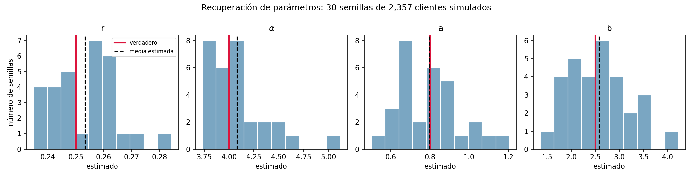

# Parte 1 — Respuestas

## 1.3 Simulación: ¿recuperamos los parámetros?

Simulamos 30 cohortes de 2,357 clientes con $r = 0.25$, $\alpha = 4$, $a = 0.8$,
$b = 2.5$ y $T \sim U(27, 39)$, y estimamos los cuatro parámetros en cada una con
nuestra verosimilitud (`src/simulacion.py`, `src/comparar_simulacion.py`).

| Parámetro | Verdadero | Media | Desv. est. | Sesgo relativo | CV | RMSE |
|---|---|---|---|---|---|---|
| $r$ | 0.25 | 0.2533 | 0.0119 | +1.3 % | 4.7 % | 0.012 |
| $\alpha$ | 4.00 | 4.0809 | 0.3004 | +2.0 % | 7.4 % | 0.306 |
| $a$ | 0.80 | 0.7980 | 0.1644 | −0.3 % | 20.6 % | 0.162 |
| $b$ | 2.50 | 2.5727 | 0.6491 | +2.9 % | 25.2 % | 0.642 |

**¿Recuperamos los parámetros?** Sí. La media de los 30 estimados está a menos del 3 %
del valor verdadero en los cuatro parámetros, y ningún sesgo es estadísticamente
distinto de cero (todos son menores que dos errores estándar de la media,
$\text{desv.}/\sqrt{30}$). El estimador y su código funcionan.