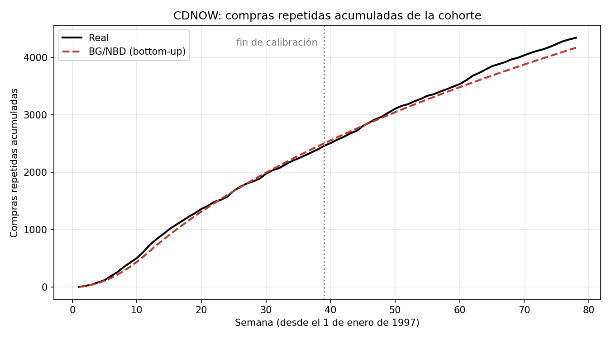

# Parte 3 — Respuestas

## 3.1 Pronóstico bottom-up

Para cada cliente $i$, con primera compra en la semana $s_i$, el número esperado de
compras repetidas acumuladas al final de la semana $w$ es $E[X(w - s_i)]$ (cero si el
cliente aún no había llegado). Sumando sobre los 2,357 clientes obtenemos la curva
esperada de la cohorte para las semanas 1 a 78 (`src/bottom_up.py`).

| | Pronóstico BG/NBD | Real |
|---|---|---|
| Acumulado a la semana 39 (calibración) | 2,501.5 | 2,457 |
| Acumulado a la semana 78 | 4,165.7 | 4,339 |
| **Total del holdout (semanas 40–78)** | **1,664.1** | **1,882** |

**¿Qué tan bien le atina al total del holdout?** El modelo pronostica 1,664 compras
repetidas en el holdout contra 1,882 reales: **subestima en 11.6 %**, con un error
absoluto medio de 9.8 compras por semana. En calibración la curva esperada prácticamente
se encima con la real, y en el holdout reproduce bien su forma (la desaceleración
conforme los clientes se van muriendo), pero se va quedando por debajo. Es decir, el
modelo predice que la cohorte se "muere" un poco más rápido de lo que en realidad pasó.

Lo notable es que el modelo logra esta curva **solo con tres números por cliente
$(x, t_x, T)$ y su fecha de primera compra**, sin ver nunca la serie agregada. La
comparación con los métodos top-down está en 3.3.

## 3.4 Pronóstico por cliente

Para cada cliente calculamos $E[Y(39) \mid x, t_x, T]$, las compras esperadas en las 39
semanas de holdout dada su historia en calibración, y comparamos por grupo de frecuencia
el promedio pronosticado contra el promedio real de $x^*$ (`src/por_cliente.py`).

| $x$ en calibración | Clientes | Promedio $E[Y(39)]$ | Promedio real $x^*$ | Error |
|---|---|---|---|---|
| 0 | 1,411 | 0.225 | 0.237 | −4.9 % |
| 1 | 439 | 0.523 | 0.697 | −24.9 % |
| 2 | 214 | 1.044 | 1.393 | −25.0 % |
| 3 | 100 | 1.520 | 1.560 | −2.5 % |
| 4 | 62 | 2.164 | 2.532 | −14.5 % |
| 5 | 38 | 2.654 | 2.947 | −10.0 % |
| 6 | 29 | 3.504 | 3.862 | −9.3 % |
| 7+ | 64 | 6.157 | 6.359 | −3.2 % |

**¿En qué grupos se equivoca más el modelo?** El modelo subestima en todos los grupos,
de forma consistente con el −11.6 % del total en 3.1. En términos relativos, los errores
más grandes están en los clientes con **una y dos compras repetidas** (−25 %): el modelo
cree que muchos de ellos ya se murieron, y en realidad volvieron más de lo esperado. En
términos absolutos, los mayores errores (unas 0.35 compras por cliente) están en los
grupos de 2, 4 y 6 compras. Los grupos 0, 3 y 7+ quedan muy cerca. Aun así, el modelo
captura muy bien la relación creciente entre frecuencia pasada y compras futuras: ordena
correctamente a los grupos de 0.23 a más de 6 compras promedio. Los grupos de 4 a 7+
tienen pocos clientes, así que sus promedios son más ruidosos.

**¿Esto lo puede hacer un pronóstico top-down?** No. Un método top-down solo ve la serie
agregada de compras semanales de toda la cohorte: puede pronosticar el total, pero no
sabe nada de cada cliente, así que no tiene forma de repartir ese total entre ellos ni de
decir que un cliente con 7 compras recientes va a comprar más que uno con una sola compra
hace meses. El BG/NBD, al ser bottom-up, produce un pronóstico para cada cliente según
su $(x, t_x, T)$, que es lo que se necesita para decisiones individuales como a quién
enviar una promoción. Esta es la información que, en términos de FPP2, se pierde al
agregar.