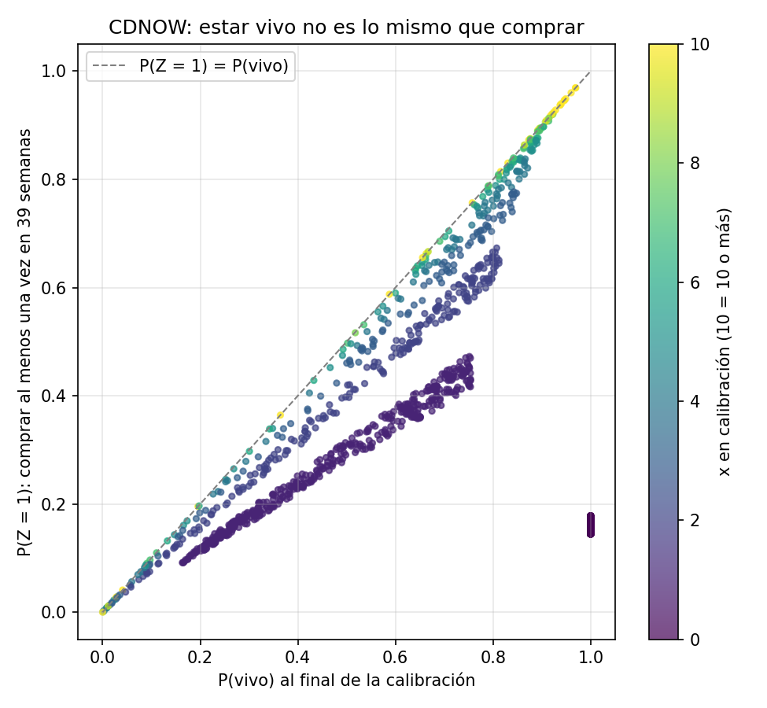

# Parte 4 — Respuestas

## 4.3 La probabilidad correcta: $P(Z = 1)$

La demostración completa está en `documentos/derivacion_bgnbd.md` (sección 4.3). El
resultado, con $\tau = 39$ semanas, es

$$
P(Z = 1 \mid x, t_x, T) = P(\text{vivo} \mid x, t_x, T) \left[ 1 - \left(\frac{\alpha+T}{\alpha+T+\tau}\right)^{r+x} \right]
$$

Se implementó en `src/bgnbd.py` (`prob_vivo`, `prob_comprar`) y se calculó para cada
cliente en `src/prob_compra.py`.

| $x$ en calibración | Clientes | Promedio $P(\text{vivo})$ | Promedio $P(Z = 1)$ | Fracción real que compró |
|---|---|---|---|---|
| 0 | 1,411 | 1.000 | 0.161 | 0.137 |
| 1 | 439 | 0.474 | 0.281 | 0.358 |
| 2 | 214 | 0.540 | 0.432 | 0.584 |
| 3 | 100 | 0.552 | 0.499 | 0.590 |
| 4 | 62 | 0.617 | 0.587 | 0.790 |
| 5 | 38 | 0.611 | 0.597 | 0.684 |
| 6 | 29 | 0.691 | 0.683 | 0.655 |
| 7+ | 64 | 0.722 | 0.720 | 0.875 |
| **Total** | **2,357** | **0.813** | **0.262** | **0.290** |

**Estar vivo no es lo mismo que comprar.** $P(\text{vivo})$ promedia 0.81 cuando solo el
29 % de los clientes compró en el holdout. $P(Z = 1)$, que multiplica $P(\text{vivo})$
por la probabilidad de que un cliente vivo compre al menos una vez en 39 semanas,
promedia 0.26, mucho más cerca de la tasa real. La diferencia se concentra en los
clientes con $x = 0$: el modelo los considera vivos con probabilidad 1, pero como su
tasa de compra posterior es muy baja ($\lambda \mid \text{vivo} \sim \text{Gamma}(r, \alpha + T)$,
con media cercana a 0.006 compras por semana), su probabilidad de comprar es solo de
0.14 a 0.18, cerca del 13.7 % observado. En cambio, para los clientes frecuentes
$P(Z = 1) \approx P(\text{vivo})$: si están vivos, casi seguro compran.

La evaluación formal de $P(Z = 1)$ como clasificador (AUC, Brier y calibración) está en 4.5.

## 4.6 Otro miembro de la familia: MBG/NBD

Implementamos el MBG/NBD en `src/mbgnbd.py` (verosimilitud, $E[X(t)]$, $E[Y(\tau)]$,
$P(\text{vivo})$ y $P(Z = 1)$) y lo ajustamos a CDNOW con el mismo optimizador que el
BG/NBD (`src/ajuste_mbgnbd.py`). Los cinco puntos iniciales convergen al mismo óptimo.
Verificamos los estimados con `ModifiedBetaGeoFitter` de la librería `lifetimes`, que da
los mismos parámetros.

| | $r$ | $\alpha$ | $a$ | $b$ | $r/\alpha$ | $a/(a+b)$ | log-verosimilitud |
|---|---|---|---|---|---|---|---|
| BG/NBD | 0.2426 | 4.4136 | 0.7929 | 2.4259 | 0.055 | 0.246 | −9582.43 |
| MBG/NBD | 0.5249 | 6.1831 | 0.8914 | 1.6140 | 0.085 | 0.356 | −9582.14 |

Los dos modelos ajustan prácticamente igual de bien (la log-verosimilitud difiere en 0.3),
pero cuentan historias distintas. El MBG/NBD permite que los clientes sin compras
repetidas ya estén muertos: su $P(\text{vivo})$ promedio es 0.41 (entre 0.39 y 0.43), en
lugar del 1 del BG/NBD. Para explicar los mismos datos, supone que los clientes que sí
siguen vivos compran más ($r/\alpha$ de 0.085 contra 0.055) y que la probabilidad de
morir tras una compra es mayor (0.36 contra 0.25).

En el total del holdout, el MBG/NBD pronostica 1,571.7 compras repetidas (bottom-up con
$E[X(t)]$) contra 1,882 reales, un error de −16.5 %, mayor que el −11.6 % del BG/NBD.

La comparación de AUC de $P(\text{vivo})$ y de $P(Z = 1)$, y la discusión de con cuál
modelo quedarse, están en la siguiente sección (D8.T2).