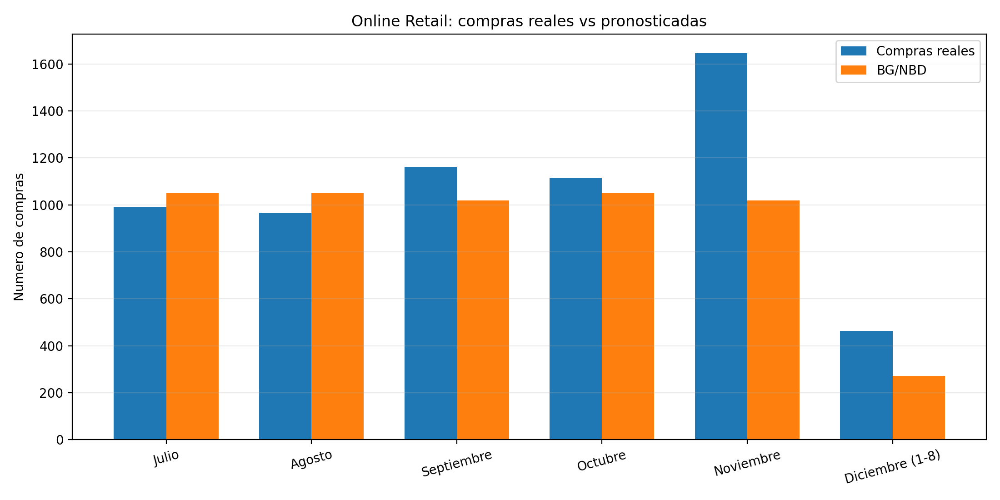

# Parte 5 — Respuestas

Preparación y detalle técnico: `limpieza_online_retail.md` y `ajuste_online_retail.md`.
Código: `src/limpiar_online_retail.py`, `src/preparacion_online_retail.py`,
`src/ajuste_online_retail.py`, `src/comparar_nbd_online_retail.py`,
`src/comparar_online_retail.py` y `src/analisis_mensual_online_retail.py`.

## 5.1 Ajuste del BG/NBD

| | r | α | a | b | E[p] | log-verosimilitud |
|---|---|---|---|---|---|---|
| CDNOW | 0.243 | 4.414 | 0.793 | 2.426 | 0.246 | −9,582.4 |
| Online Retail | 0.739 | 9.199 | 0.0002 | 264 | ≈ 10⁻⁶ | −15,181.7 |

**¿Qué le pasó al modelo?** a se fue prácticamente a cero y b a un valor grande y arbitrario
(no está identificado: otros puntos iniciales dan otro b con la misma verosimilitud). La
probabilidad media de morir después de una compra es prácticamente cero: en promedio, un
cliente haría cerca de un millón de compras antes de morir. **El modelo "apagó" la muerte y
se convirtió en un NBD**, el abuelo de la familia en el que nadie se muere. Lo comprobamos
ajustando el NBD directamente (`src/comparar_nbd_online_retail.py`): su log-verosimilitud
es idéntica (−15,181.72 en ambos). En CDNOW, en cambio, agregar la muerte mejora la
log-verosimilitud en 181 unidades.

**¿Qué quiere decir sobre la muerte de los clientes?** Que en la ventana de calibración los
datos no muestran ninguna señal de abandono que el modelo pueda separar de la simple
heterogeneidad en las tasas de compra. Para este BG/NBD, un cliente que no ha vuelto es
alguien con λ baja, no alguien que se murió, y P(vivo) ≈ 1 para todos.

**¿Por qué pasa aquí y no en CDNOW?** Tres razones que se refuerzan:

1. **Quiénes son los clientes.** Online Retail vende al por mayor (artículos de regalo) y
   muchos de sus clientes son negocios que reabastecen inventario con regularidad. Una
   relación comercial de ese tipo no se abandona después de una compra al azar, que es la
   historia que cuenta el BG/NBD. Los clientes de CDNOW eran consumidores que probaban
   comprar CDs por internet en 1997, y muchos no volvieron nunca.
2. **No es una cohorte de clientes nuevos.** Los datos empiezan el 1 de diciembre de 2010,
   así que la "primera compra" del 29.8 % de la cohorte es solo la primera que vemos: son
   clientes antiguos que ya habían sobrevivido a muchas compras. En CDNOW todos son
   clientes realmente nuevos del primer trimestre de 1997, y el BG/NBD supone que
   observamos la relación desde su inicio.
3. **La calibración es corta.** Son 30 semanas (18.8 en promedio por cliente), contra 39 en
   CDNOW. Con poco tiempo no hay forma de distinguir a quien se murió de quien compra poco.
   Los datos lo confirman: **el 50 % de los clientes con x = 0 compró en el holdout**,
   contra el 13.7 % en CDNOW.

## 5.2 Total del holdout

| | Real | BG/NBD | Error |
|---|---|---|---|
| Total del holdout (1 jul – 8 dic) | 6,344 | 5,463 | −13.9 % |
| Julio a octubre | 4,235 | 4,174 | −1.4 % |
| Noviembre | 1,646 | 1,018 | −38.2 % |
| 1 al 8 de diciembre | 463 | 271 | −41.4 % |

El BG/NBD subestima el total en 13.9 %, pero el error no está repartido: **de julio a
octubre el pronóstico es casi exacto (−1.4 %) y casi todo el faltante está en noviembre y
diciembre.** Como el modelo terminó siendo un NBD sin muerte, su pronóstico es una tasa
constante por cliente y reparte las compras en proporción a los días de cada mes. Esto
conecta directamente con lo que vimos en la tarea de series de tiempo: noviembre es el mes
pico del año, porque los clientes mayoristas se abastecen para la temporada navideña. El
BG/NBD supone que cada cliente compra como un proceso de Poisson **estacionario** y no
tiene forma de representar estacionalidad; además, la calibración (diciembre a junio) solo
contiene el final de una temporada navideña, así que no tuvo un noviembre del cual
aprender.

Por segmentos (`resultados/tablas/online_retail_holdout_segmentos.csv`), el modelo también
subestima más a los clientes más frecuentes (7+ compras repetidas), que son los que más
compran en temporada alta.

La lección: el total de un BTYD solo es tan bueno como su supuesto de estacionariedad. Un
pronóstico útil aquí combinaría el BG/NBD (que reparte bien entre clientes) con un factor
estacional estimado en la serie agregada, como en la tarea.