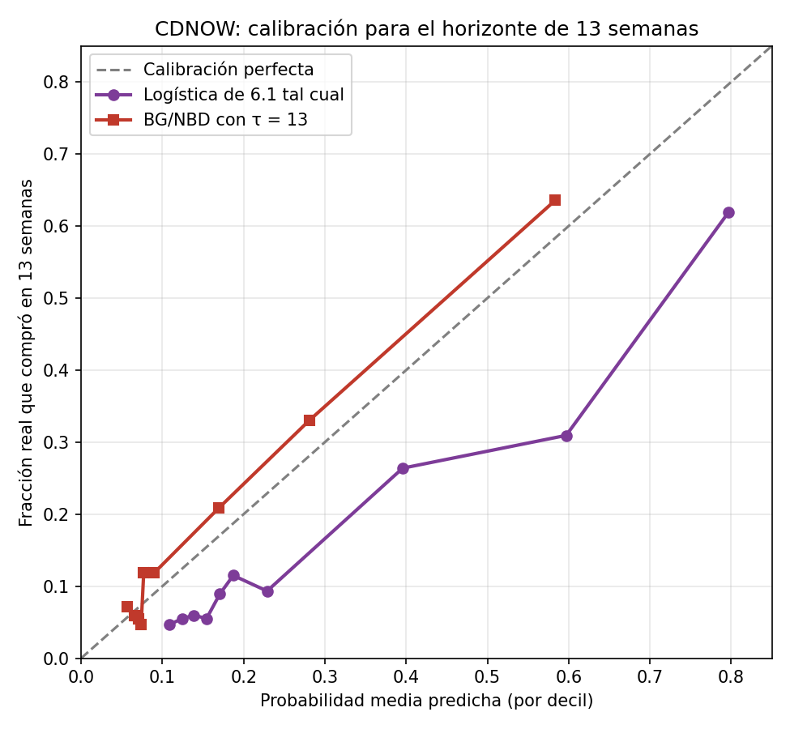

## 6.4 Cambiar la pregunta: de 39 a 13 semanas

El gerente ahora quiere saber quién compra en las próximas 13 semanas. **Con el BG/NBD
solo cambia $\tau$:** usamos la misma fórmula de 4.3 con $\tau = 13$, sin reentrenar
nada. **Con la logística de 6.1 habría que volver a entrenarla** con etiquetas de 13
semanas, porque aprendió a predecir compra en 39. Para ver qué pasa si no se hace, la
usamos tal cual (predicciones fuera de muestra, 5 folds × 20 semillas) para predecir si
el cliente compra en las primeras 13 semanas del holdout, del 1 de octubre al 30 de
diciembre de 1997 (`src/cambio_horizonte.py`).

| Horizonte | Modelo | Probabilidad media | Tasa real | AUC | Brier | Brier tasa base |
|---|---|---|---|---|---|---|
| 39 | Logística | 0.290 | 0.290 | 0.778 | 0.156 | 0.206 |
| 39 | BG/NBD, $\tau = 39$ | 0.262 | 0.290 | 0.757 | 0.161 | 0.206 |
| 13 | Logística tal cual | 0.290 | 0.171 | 0.789 | 0.129 | 0.142 |
| 13 | BG/NBD, $\tau = 13$ | 0.154 | 0.171 | 0.785 | 0.110 | 0.142 |

**¿Qué pasó?** La logística sigue prediciendo el nivel de 39 semanas: en promedio da una
probabilidad de 0.29 cuando solo el 17 % compró en 13 semanas, es decir, sobreestima en
casi 70 %, y su curva de calibración queda muy por debajo de la diagonal en todos los
deciles. Su AUC sigue siendo alto (0.789) porque los clientes que compran en 39 semanas
son, en buena medida, los mismos que compran en 13: **ordena bien, pero estima mal los
niveles**. La razón es que la logística no tiene ninguna noción de tiempo: aprende una
relación entre $(x, t_x, T)$ y una etiqueta con un horizonte fijo, y no sabe convertirla
a otro horizonte. El BG/NBD, en cambio, es un modelo del proceso de compra en el tiempo:
el horizonte es un argumento de la fórmula, así que cambiar la pregunta solo cambia
$\tau$. Con $\tau = 13$ predice 15.4 % contra 17.1 % real, queda cerca de la diagonal y
tiene un Brier mejor que la logística (0.110 contra 0.129). A 39 semanas la logística le
ganaba en AUC y Brier, pero esa ventaja venía de haber aprendido con las etiquetas del
mismo periodo (inciso 6.2) y desaparece en cuanto la pregunta cambia.